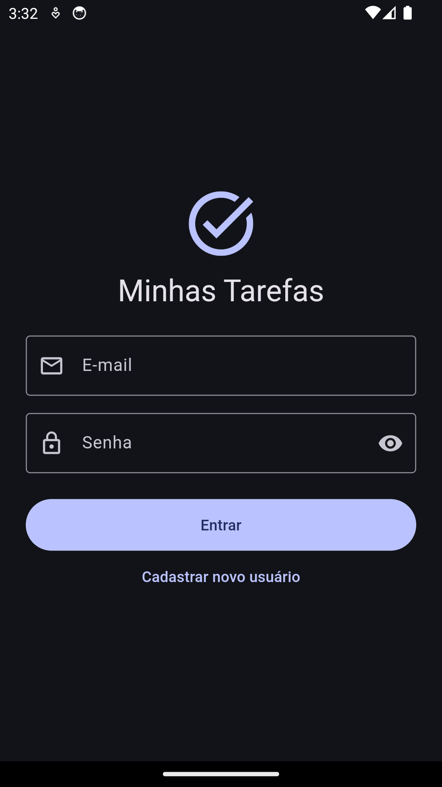
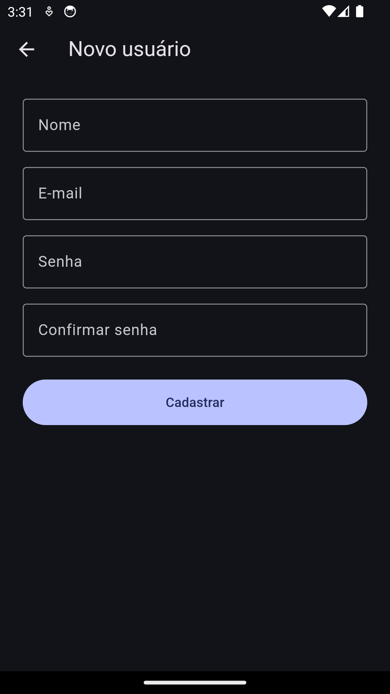
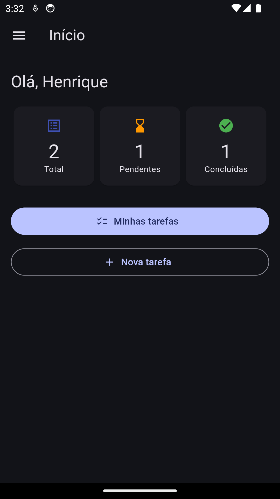
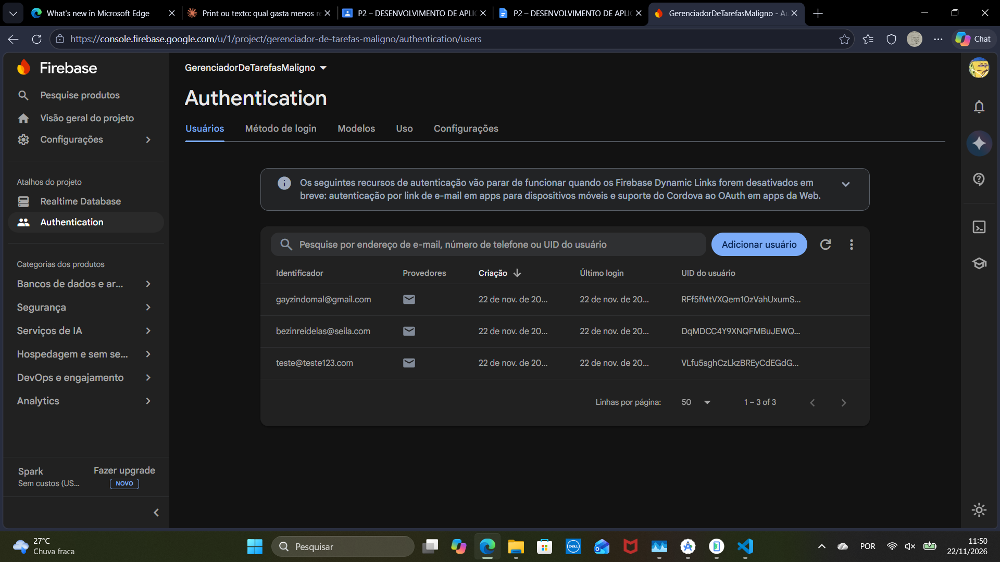
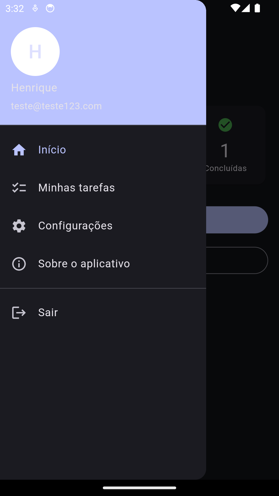
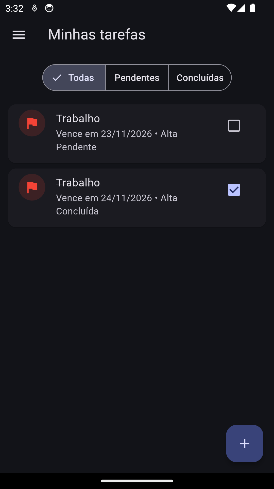
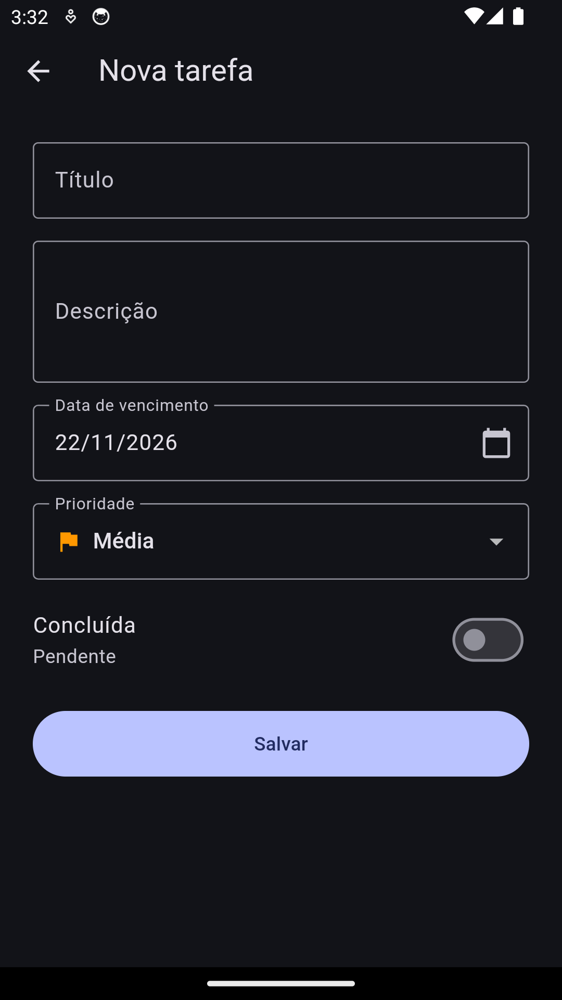
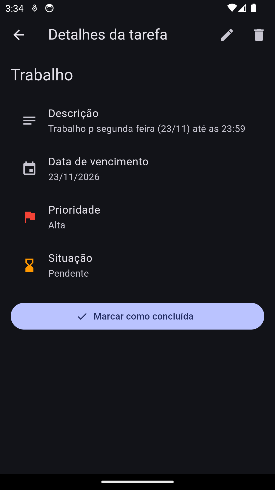
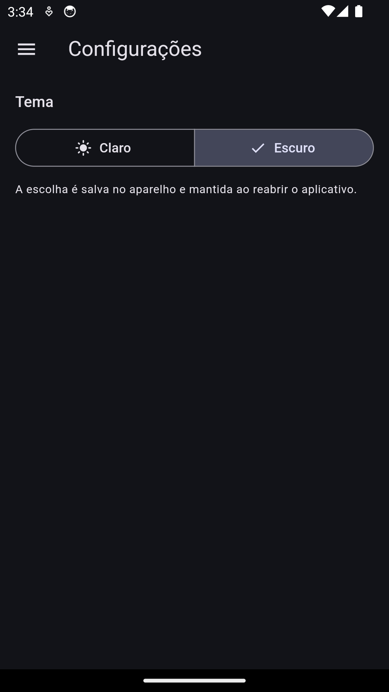
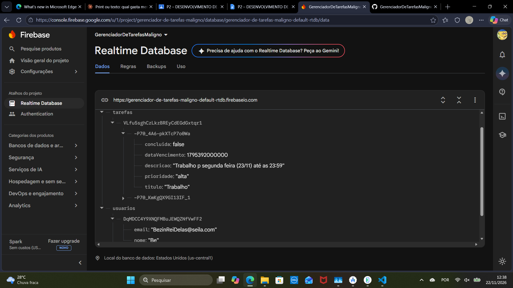

# Gerenciador de Tarefas

Aplicativo mobile em Flutter para gerenciamento de tarefas pessoais. Cada usuário
se cadastra com e-mail e senha, e suas tarefas ficam salvas na nuvem
(Firebase Realtime Database), visíveis apenas para ele.

## Funcionalidades

- **Autenticação (Firebase Authentication):** cadastro com nome, e-mail e senha, login, logout e sessão mantida ao reabrir o app.
- **Tela inicial:** nome do usuário e quantidade de tarefas (total, pendentes e concluídas), atualizadas em tempo real.
- **Menu lateral (Drawer):** nome e e-mail do usuário, com as opções Início, Minhas tarefas, Configurações, Sobre o aplicativo e Sair.
- **Tarefas:** cadastro, listagem (`ListView`), detalhes, edição, exclusão e alternância entre pendente e concluída. Cada tarefa tem título, descrição, data de vencimento e prioridade (Baixa, Média ou Alta, identificadas por cores).
- **Tempo real:** listeners do Realtime Database atualizam as telas automaticamente.
- **Isolamento por usuário:** as tarefas ficam em `tarefas/{uid}`, e as regras do banco impedem acesso aos dados de outros usuários.
- **Preferências (SharedPreferences):** tema claro ou escuro, salvo e restaurado ao abrir o app.
- **Temas:** `ThemeData`, `ThemeMode`, `lightTheme` e `darkTheme`, aplicados em todas as telas, inclusive login e cadastro.

## Tecnologias

Flutter e Dart, Firebase Authentication, Firebase Realtime Database, SharedPreferences.

## Estrutura do projeto

```
lib/
├── main.dart
├── firebase_options.dart
├── models/
│   ├── usuario.dart
│   └── tarefa.dart
├── screens/
│   ├── auth_gate.dart
│   ├── login_screen.dart
│   ├── cadastro_usuario_screen.dart
│   ├── home_screen.dart
│   ├── tarefas_screen.dart
│   ├── tarefa_detalhes_screen.dart
│   ├── cadastro_tarefa_screen.dart
│   └── configuracoes_screen.dart
├── services/
│   ├── auth_service.dart
│   ├── firebase_service.dart
│   └── preferences_service.dart
├── widgets/
│   └── drawer_menu.dart
└── themes/
    └── app_theme.dart
```

## Como executar

### Pré-requisitos

- Flutter SDK 3.27 ou superior
- Android Studio com um emulador Android (ou um celular com Depuração USB)
- Node.js (para as ferramentas do Firebase)
- Uma conta Google

### 1. Obter o código

```
git clone <URL-DO-REPOSITORIO>
cd GerenciadorDeTarefasMaligno
flutter pub get
```

### 2. Opção A: usar o projeto Firebase do autor

O repositório inclui `lib/firebase_options.dart` e `android/app/google-services.json`,
já ligados ao projeto Firebase do autor. Se o projeto estiver ativo, basta pular
para o passo 3.

### 2. Opção B: usar o seu próprio projeto Firebase

1. No [console do Firebase](https://console.firebase.google.com), crie um projeto.
2. Em **Authentication > Sign-in method**, habilite **E-mail/senha**.
3. Em **Realtime Database**, crie um banco de dados (modo bloqueado).
4. Na aba **Regras** do Realtime Database, cole o conteúdo de `database.rules.json` e publique.
5. Instale as ferramentas e conecte o app ao projeto:

```
npm install -g firebase-tools
dart pub global activate flutterfire_cli
firebase login
flutterfire configure
```

Escolha o seu projeto e marque a plataforma **android**. O comando substitui
`lib/firebase_options.dart` e `android/app/google-services.json` pelos do seu projeto.
Se criar o Realtime Database depois de rodar o `flutterfire configure`, rode o comando de novo
para que o `databaseURL` entre no arquivo.

Caso o comando `flutterfire` não seja reconhecido, use:

```
dart pub global run flutterfire_cli:flutterfire configure
```

### 3. Rodar o aplicativo

Selecione um emulador Android (ou um celular conectado) e execute:

```
flutter run
```

Para uma versão mais fluida (sem hot reload): `flutter run --release`.

### Observações sobre o emulador

Em computadores sem placa de vídeo dedicada, o emulador pode ficar lento ou
mostrar tela branca na abertura. Se isso ocorrer, adicione dentro da tag
`<application>` do `android/app/src/main/AndroidManifest.xml`:

```xml
<meta-data
    android:name="io.flutter.embedding.android.EnableImpeller"
    android:value="false" />
```

## Como testar

1. Crie uma conta em **Cadastrar novo usuário**. O app entra direto no Início.
2. Cadastre tarefas e acompanhe os contadores do Início.
3. Em **Minhas tarefas**, alterne a situação, abra os detalhes, edite e exclua.
4. Em **Configurações**, troque o tema, feche o app e reabra para conferir se ele foi mantido.
5. Use **Sair** e entre de novo com a mesma conta.
6. Crie uma segunda conta e confira que ela não enxerga as tarefas da primeira.

## Capturas de tela

| Login | Cadastro | Início | Autenticação |
|---|---|---|---|
|  |  |  |  |

| Menu lateral | Minhas tarefas | Nova tarefa |
|---|---|---|
|  |  |  |

| Detalhes | Configurações (tema escuro) | Realtime Database |
|---|---|---|
|  |  |  |

## Vídeos de demonstração

### Funcionamento do aplicativo
[▶ Assistir ao vídeo](https://youtu.be/GTHRxwgq6d8)

### Dados salvos no Firebase
[▶ Assistir ao vídeo](https://youtu.be/AnZt_t2UeA0)

## Regras de segurança do banco

O arquivo `database.rules.json` restringe a leitura e a gravação dos nós `usuarios/{uid}`
e `tarefas/{uid}` ao próprio usuário autenticado.
